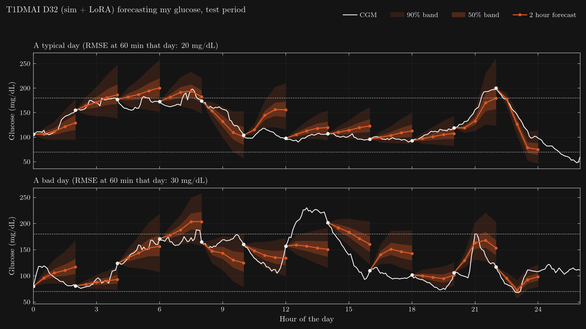

# T1DMAI

T1DMAI is a small transformer that forecasts my blood glucose up to 2 hours ahead. This page
compares it with 18 other forecasting methods on my own CGM data and on the public MetaboNet
dataset.

Here it is forecasting my glucose on two days it never saw during training. Every 2 hours it
makes a new 2 hour forecast. The shaded areas are its 50% and 90% bands.



> [!CAUTION]
> **Research and educational use only - not a medical device.** T1DMAI is a
> research artifact. It is **not** clinically validated, has **no** regulatory
> clearance, and its output is a forecast of research signals, not medical
> advice. It **must not** be used to make medical, diagnostic, or treatment
> decisions, to calculate or adjust insulin doses, or to manage diabetes in any
> way. For medical guidance consult a qualified healthcare professional. The
> software is provided "as is", without warranty of any kind (see
> [LICENSE](LICENSE)).

## Contents

1. [Background](#1-background)
2. [Main results](#2-main-results)
3. [Models](#3-models)
4. [Data](#4-data)
5. [Method](#5-method)
6. [Results](#6-results)
   - [6.1 Overall accuracy](#61-overall-accuracy)
   - [6.2 Spread across days and people](#62-spread-across-days-and-people)
   - [6.3 Error by situation](#63-error-by-situation)
   - [6.4 Lows and clinical risk](#64-lows-and-clinical-risk)
   - [6.5 Uncertainty bands](#65-uncertainty-bands)
   - [6.6 Example forecasts](#66-example-forecasts)
   - [6.7 Simulator pretraining](#67-simulator-pretraining)
   - [6.8 Speed and size](#68-speed-and-size)
7. [Limitations](#7-limitations)
8. [Glossary](#8-glossary)
9. [Full tables](#9-full-tables)
10. [Reproduce](#10-reproduce)

## 1. Background

I have type 1 diabetes and wear a CGM. The CGM shows my glucose now and a trend arrow. I wanted
to see where it will be in an hour or two, so I wrote three programs:

- [T1DMSIM](https://github.com/0xdeadf1sh/T1DMSIM) simulates people with T1D: meals, insulin and
  sensor noise.
- T1DMAI (this repo) is a small transformer trained on 1 million simulated people.
- [T1DMDROID](https://github.com/0xdeadf1sh/T1DMDROID) is an Android app that runs the model on
  my phone.

After building it I wanted to know how it does against methods people already use. I followed
the checklist for glucose forecasting studies in Jacobs et al., IEEE Reviews in Biomedical
Engineering, 2024.

## 2. Main results

All errors are RMSE in mg/dL at 60 minutes unless I say otherwise. Lower is better. Numbers in
square brackets are 95% intervals.

1. On MetaboNet, T1DMAI trained on the real data alone came first out of 29 models. D32 from
   scratch scored 32.0 [31.0 to 33.1]. The best other model was XGBoost at 33.2 [32.1 to 34.3].
   The two intervals overlap. A paired Wilcoxon test on the same forecasts finds XGBoost
   significantly worse at every horizon. Two training seeds landed within 0.1 of each other.
2. Pretraining on the simulator made T1DMAI worse on MetaboNet. The same D32 model scored 36.0
   with the simulator only, 34.3 with the simulator plus LoRA, and 32.0 with no simulator.
3. On my data, XGBoost trained on 80 days of my real record scored 22.2. T1DMAI trained only on
   1 million simulated people scored 25.9.
4. Adding a LoRA adapter trained on those 80 days brought T1DMAI D32 to 22.4 [20.5 to 24.2].
   That is a statistical tie with XGBoost (22.2 [20.5 to 24.0]) at all four horizons.
5. The models with the lowest RMSE catch the fewest lows. On MetaboNet at 60 min, T1DMAI from
   scratch caught 3% of real lows and XGBoost caught 0%. The Kalman filter caught 26% and plain
   linear extrapolation caught 58%.
6. All models drift towards the middle of the range. When glucose was really below 70, every
   model except linear extrapolation forecast too high on average (+5 to +31 on my data, +24 to
   +46 on MetaboNet). Above 180 they all forecast too low (-18 to -41 on my data, -12 to -36 on
   MetaboNet).
7. Nights are easy and meals are hard. On MetaboNet the best model scored 20.7 at night and 35.1
   during the day. It scored 38.9 in the 2 hours after a logged meal and 28.4 the rest of the
   time.
8. People vary much more than models do. Across 257 MetaboNet people the best model's RMSE went
   from 12 to 51, and the middle half of people fell between 27.5 and 37.2. The gap between the
   best model and XGBoost is 1.2.
9. T1DMAI's bands are well calibrated on MetaboNet when trained from scratch. The 90% band held
   the real value 86 to 91% of the time. On my data the sim only bands held it 86 to 90% of the
   time. After LoRA that dropped to 72 to 76%, so those bands are too narrow.
10. On my data T1DMAI with LoRA reacts to changes earliest. Its time gain at 60 min is 45 to 50
    min. XGBoost gets 30 min and persistence gets 0.
11. Chronos-Bolt used zero-shot on my data scored 30.8 to 30.9. ARIMA scored 31.4.
12. T1DMAI is the slowest model I tested. One forecast takes 6 to 16 ms on one CPU thread, about
    30 times longer than XGBoost (0.5 ms), because it reads 7 days of history. The app needs one
    forecast every 5 minutes.

## 3. Models

| Model | Family | Description |
| --- | --- | --- |
| Persistence | Baseline | Assumes glucose stays where it is now. Any useful model should beat it. |
| Linear extrapolation | Baseline | Fits a straight line to the last few readings and extends it. |
| AR (ridge) | Classical | Linear regression on recent glucose. |
| ARX (ridge) | Classical | Linear regression on recent glucose, insulin and carbs. |
| ARIMA | Classical | Standard statistical time series model, glucose only. |
| SARIMAX | Classical | ARIMA with insulin and carbs added. |
| Kalman filter | Classical | Tracks the glucose level and its trend and lets the trend fade out. |
| SVR | Classical | Support vector regression on glucose, insulin and carbs. |
| Sparse GP | Classical | Gaussian process regression with 1000 inducing points. |
| XGBoost | Classical | Gradient boosted trees on glucose, insulin and carbs. |
| LSTM | Deep | Recurrent network over 2 hours of history (Martinsson et al. 2019). |
| GluNet | Deep | Dilated causal convolutions over 4 hours (Li et al. 2020). |
| PatchTST | Deep | Transformer that reads glucose in chunks. |
| N-HiTS | Deep | Stacked MLPs that forecast at several time scales. |
| Chronos-Bolt tiny and mini | Foundation | Amazon's pretrained time series models (9M and 21M parameters). They see glucose only. I ran them zero-shot and fine-tuned. |
| T1DMAI D16 and D32 | T1DMAI | My model, 31k and 238k parameters. It sees glucose, carbs and insulin. |

The two baselines have nothing to train. Chronos-Bolt starts from Amazon's weights. I trained
all the other models from scratch on the training part of each dataset.

I tried T1DMAI in three ways:

| Path | Meaning |
| --- | --- |
| sim only | Trained on simulated people only. It never saw a real reading. |
| sim + LoRA | The sim only model with a small LoRA adapter (rank 4) trained on the real training data. The original weights stay frozen. |
| from scratch | Same architecture trained on real training data only, with no simulator. I only did this on MetaboNet. |

<details>
<summary>T1DMAI details</summary>

| | |
| --- | --- |
| Architecture | encoder-only transformer, 30 min patches, one attention head, RoPE, SwiGLU |
| Sizes | D16 is 16 layers of width 16 (31k parameters). D32 is 32 layers of width 32 (238k). |
| Loss | 7 quantile pinball loss plus a median term (DILATE or MSE) |
| Inputs | CGM in a risk-scaled space, carb absorption curve, insulin action curve, mask bit |
| Output | 7 quantiles (5% to 95%) for every 5 minute step of the next 2 hours |
| History | up to 7 days |
| Simulator training | 1M simulated people, 7 days each, 10000 steps of batch 512 |
| LoRA | rank 4 on every linear layer, merged into the weights after training |
| Runtime | ExecuTorch or LiteRT, on the phone in T1DMDROID |

More in [docs/USAGE.md](docs/USAGE.md) and [ARCHITECTURE.md](ARCHITECTURE.md).

</details>

## 4. Data

**My data.** 115 days of CGM, insulin and carb logs exported from T1DMDROID. Days 1 to 80 are
for training and the last 35 days are for testing. The models get the carbs and insulin I
logged for the 2 hours after each forecast. This is the "non-blind" setting, useful for asking
what happens if I eat something.

| Source | Subjects | Person-days | Forecasts | CGM coverage % | Mean mg/dL | CV % | < 54 % | < 70 % | 70-180 % | > 180 % | > 250 % |
| --- | ---: | ---: | ---: | ---: | ---: | ---: | ---: | ---: | ---: | ---: | ---: |
| t1dmdroid | 1 | 35 | 9764 | 97 | 130 | 28 | 0.4 | 3.0 | 89 | 8 | 0 |


**MetaboNet.** A public collection of T1D studies. I used its official train and test split.
The test split has 279 people from 9 of the studies. Here the models get no future carbs or
insulin. This is the "blind" setting. Most of these people use closed-loop pumps, and the logged
future insulin is the pump reacting to glucose the model has not seen yet. Giving it to the
model would leak the answer.

| Source | Subjects | Person-days | Forecasts | CGM coverage % | Mean mg/dL | CV % | < 54 % | < 70 % | 70-180 % | > 180 % | > 250 % |
| --- | ---: | ---: | ---: | ---: | ---: | ---: | ---: | ---: | ---: | ---: | ---: |
| AZT1D | 4 | 131 | 775 | 99 | 141 | 30 | 0.3 | 1.3 | 82 | 17 | 2 |
| BrisT1D | 2 | 312 | 1953 | 77 | 144 | 33 | 0.2 | 1.8 | 78 | 20 | 3 |
| CTR3 | 5 | 1157 | 1052 | 51 | 141 | 38 | 0.7 | 3.5 | 78 | 19 | 4 |
| HUPA-UCM | 4 | 315 | 896 | 100 | 132 | 36 | 0.9 | 6.8 | 78 | 16 | 2 |
| IOBP2 | 62 | 4737 | 14653 | 84 | 159 | 37 | 0.4 | 2.0 | 68 | 30 | 8 |
| Loop | 159 | 47438 | 203538 | 93 | 139 | 40 | 0.7 | 3.9 | 77 | 19 | 5 |
| PEDAP | 6 | 2070 | 6321 | 85 | 158 | 38 | 0.4 | 2.4 | 68 | 29 | 9 |
| ReplaceBG | 35 | 7967 | 35683 | 87 | 158 | 41 | 1.0 | 4.2 | 64 | 32 | 9 |
| ShanghaiT1DM | 2 | 19 | 28 | 33 | 159 | 39 | 1.0 | 3.8 | 63 | 33 | 7 |
| All | 279 | 64146 | 264899 | 90 | 143 | 40 | 0.7 | 3.7 | 75 | 22 | 6 |


## 5. Method

| | My data | MetaboNet |
| --- | --- | --- |
| Training data | days 1 to 80 | official train split |
| Test data | days 81 to 115, a forecast every 5 min | every 10th row of the official leaderboard template |
| Future carbs and insulin | given as logged | hidden |
| Horizons | 30, 60, 90, 120 min | 30, 60, 90, 120 min |
| Training windows for the other models | 60000 | 351000 (200000 for fine-tuned Chronos) |
| T1DMAI paths | sim only, sim + LoRA (2000 steps) | sim only, sim + LoRA, from scratch (10000 steps, 2 seeds) |
| Checkpoint | last one | last one |

I did not pick any setting or checkpoint by looking at test scores.

All models forecast at the same moments. When a model has too little history to forecast at
some moment, its forecast falls back to the last CGM reading and still counts.

The 95% intervals come from a bootstrap that resamples whole people (MetaboNet) or whole days
(my data). Forecasts 5 minutes apart are strongly correlated, so resampling single forecasts
would make the intervals look too narrow.

"Not significantly worse" means a Wilcoxon signed-rank test on the paired absolute errors
against the best model, with a Bonferroni correction for the number of models.

## 6. Results

### 6.1 Overall accuracy

RMSE at 30, 60 and 120 min. Lower is better. My model is in orange.


RMSE by horizon for the best model of each family:


RMSE at 60 min with 95% intervals. When two bars overlap a lot, the difference could be luck.


Models that are statistically tied with the best one:


### 6.2 Spread across days and people

Each box shows how RMSE at 60 min varies across test days (my data) or across people
(MetaboNet, people with at least 100 forecasts).


<details>
<summary>RMSE at 60 min per MetaboNet study</summary>

| Model | AZT1D | BrisT1D | CTR3 | HUPA-UCM | IOBP2 | Loop | PEDAP | ReplaceBG | ShanghaiT1DM |
| --- | ---: | ---: | ---: | ---: | ---: | ---: | ---: | ---: | ---: |
| T1DMAI D32 MSE (from scratch, seed 43) | 28.0 | 35.6 | 31.8 | 26.2 | 34.8 | 31.4 | 43.6 | 31.4 | 34.8 |
| T1DMAI D32 MSE (from scratch) | 27.8 | 35.5 | 31.7 | 26.3 | 35.0 | 31.5 | 44.0 | 31.5 | 34.8 |
| T1DMAI D16 MSE (from scratch, seed 43) | 28.5 | 36.1 | 32.4 | 26.8 | 35.5 | 31.8 | 44.1 | 31.9 | 34.8 |
| T1DMAI D16 MSE (from scratch) | 28.5 | 35.9 | 32.0 | 26.3 | 35.6 | 31.9 | 44.5 | 31.8 | 34.8 |
| T1DMAI D16 DILATE (from scratch) | 29.3 | 36.9 | 32.9 | 26.7 | 36.1 | 32.2 | 45.2 | 32.2 | 34.8 |
| XGBoost | 29.4 | 36.5 | 31.5 | 27.1 | 36.1 | 32.6 | 45.0 | 32.7 | 32.3 |
| SVR | 29.9 | 37.2 | 33.1 | 26.8 | 37.3 | 33.3 | 46.6 | 33.7 | 34.4 |
| T1DMAI D32 MSE (sim + LoRA) | 29.9 | 38.3 | 33.8 | 27.6 | 37.5 | 33.7 | 47.3 | 33.2 | 34.8 |
| Sparse GP | 29.8 | 37.4 | 32.5 | 27.4 | 37.2 | 33.7 | 46.5 | 34.0 | 30.1 |
| N-HiTS | 30.9 | 37.3 | 35.0 | 28.6 | 37.1 | 33.7 | 46.8 | 34.5 | 34.2 |
| PatchTST | 30.7 | 38.0 | 33.4 | 27.3 | 37.7 | 33.8 | 47.5 | 34.2 | 36.9 |
| T1DMAI D16 DILATE (sim + LoRA) | 30.2 | 39.1 | 33.3 | 27.4 | 37.6 | 34.0 | 46.5 | 33.2 | 34.8 |
| Chronos-Bolt mini (fine-tuned) | 29.6 | 37.3 | 31.9 | 27.6 | 38.2 | 34.0 | 46.7 | 33.5 | 32.8 |
| Chronos-Bolt tiny (fine-tuned) | 29.4 | 37.5 | 31.7 | 27.6 | 38.3 | 34.1 | 47.0 | 33.6 | 32.8 |
| GluNet | 31.1 | 38.3 | 34.3 | 28.3 | 38.0 | 34.1 | 48.5 | 34.8 | 32.9 |
| T1DMAI D16 MSE (sim + LoRA) | 30.8 | 38.9 | 33.4 | 27.7 | 38.3 | 34.6 | 47.5 | 33.8 | 34.8 |
| ARX (ridge) | 30.3 | 38.5 | 32.9 | 27.8 | 38.6 | 34.8 | 48.0 | 34.8 | 32.4 |
| AR (ridge) | 30.8 | 39.2 | 32.6 | 28.3 | 38.6 | 35.1 | 47.9 | 34.6 | 30.8 |
| LSTM | 31.5 | 39.7 | 35.5 | 28.6 | 39.5 | 35.1 | 50.0 | 35.7 | 34.5 |
| T1DMAI D32 MSE (sim only) | 31.4 | 38.7 | 33.3 | 28.4 | 38.6 | 35.4 | 47.7 | 35.8 | 34.8 |
| T1DMAI D16 DILATE (sim only) | 31.9 | 40.0 | 34.0 | 28.8 | 39.3 | 36.1 | 49.5 | 35.8 | 34.8 |
| T1DMAI D16 MSE (sim only) | 32.6 | 39.8 | 33.9 | 29.1 | 39.2 | 36.2 | 48.2 | 35.7 | 34.8 |
| Chronos-Bolt tiny (zero-shot) | 32.1 | 41.3 | 34.9 | 29.2 | 41.8 | 37.1 | 51.4 | 36.0 | 36.7 |
| Chronos-Bolt mini (zero-shot) | 32.5 | 41.3 | 35.2 | 29.4 | 42.0 | 37.1 | 51.3 | 36.1 | 36.4 |
| Kalman filter | 33.7 | 43.6 | 35.5 | 29.9 | 42.6 | 37.9 | 53.2 | 36.6 | 34.5 |
| SARIMAX | 34.4 | 44.0 | 37.9 | 29.9 | 44.4 | 38.4 | 54.5 | 38.0 | 38.2 |
| Persistence | 35.8 | 44.0 | 37.4 | 32.2 | 44.6 | 39.3 | 54.7 | 38.9 | 34.8 |
| ARIMA | 37.4 | 47.5 | 39.8 | 33.6 | 46.9 | 41.2 | 58.2 | 40.3 | 38.2 |
| Linear extrapolation | 47.3 | 70.5 | 51.0 | 43.2 | 63.6 | 59.3 | 78.7 | 52.1 | 48.5 |

</details>

### 6.3 Error by situation

RMSE at 60 min split by the glucose level at the target time, by time of day, and by whether a
meal was logged in the 2 hours before the forecast. In the tables the number in brackets is the
mean error. A positive mean error means the forecast was too high.


<details>
<summary>Tables</summary>

**My data**

| Model | < 70 | 70-180 | > 180 | night | day | meal in last 2 h | no meal |
| --- | ---: | ---: | ---: | ---: | ---: | ---: | ---: |
| XGBoost | 22.8 (+18) | 20.1 (+2) | 38.9 (-24) | 17.6 (+0) | 23.6 (+1) | 23.2 (+3) | 21.7 (-1) |
| T1DMAI D32 MSE (sim + LoRA) | 21.0 (+15) | 20.5 (+2) | 38.0 (-23) | 18.0 (+1) | 23.7 (-0) | 23.4 (+4) | 21.8 (-2) |
| T1DMAI D16 DILATE (sim + LoRA) | 19.5 (+14) | 20.7 (+1) | 37.2 (-24) | 18.9 (+4) | 23.5 (-2) | 23.5 (+2) | 21.8 (-2) |
| SVR | 20.2 (+14) | 20.9 (+1) | 40.2 (-26) | 17.4 (-2) | 24.5 (-0) | 24.1 (+1) | 22.3 (-2) |
| T1DMAI D16 MSE (sim + LoRA) | 18.1 (+12) | 21.6 (+2) | 36.9 (-22) | 19.6 (+2) | 24.1 (+0) | 24.5 (+4) | 22.2 (-1) |
| PatchTST | 20.6 (+12) | 21.8 (+3) | 37.2 (-21) | 18.6 (-1) | 24.7 (+2) | 25.1 (+3) | 22.2 (+0) |
| Sparse GP | 24.8 (+19) | 21.4 (+3) | 39.7 (-27) | 18.2 (+1) | 25.0 (+1) | 25.1 (+3) | 22.5 (-0) |
| GluNet | 19.7 (+9) | 22.0 (+3) | 38.0 (-21) | 18.4 (-2) | 25.1 (+2) | 25.0 (+3) | 22.8 (-0) |
| ARX (ridge) | 25.7 (+22) | 21.9 (+3) | 41.0 (-30) | 19.1 (-0) | 25.5 (+1) | 26.2 (+2) | 22.7 (+0) |
| LSTM | 18.9 (+5) | 22.9 (+2) | 37.3 (-20) | 19.8 (-3) | 25.6 (+1) | 25.2 (+1) | 23.7 (-1) |
| N-HiTS | 21.5 (+8) | 23.5 (+4) | 38.8 (-18) | 20.2 (+0) | 26.4 (+3) | 26.3 (+4) | 24.2 (+1) |
| T1DMAI D32 MSE (sim only) | 25.9 (+21) | 23.1 (+3) | 46.8 (-36) | 19.7 (-2) | 27.7 (+1) | 27.7 (+4) | 24.8 (-2) |
| T1DMAI D16 DILATE (sim only) | 25.3 (+20) | 23.6 (+3) | 45.7 (-35) | 20.3 (-3) | 27.8 (+2) | 28.7 (+6) | 24.5 (-2) |
| T1DMAI D16 MSE (sim only) | 27.1 (+22) | 24.2 (+4) | 49.0 (-39) | 20.0 (-1) | 29.1 (+2) | 29.9 (+6) | 25.4 (-2) |
| AR (ridge) | 32.9 (+31) | 24.0 (+2) | 50.4 (-41) | 21.5 (-0) | 29.0 (-0) | 30.4 (+1) | 25.3 (-1) |
| Chronos-Bolt tiny (fine-tuned) | 26.3 (+23) | 24.2 (+0) | 50.4 (-38) | 21.2 (-2) | 29.0 (-2) | 30.5 (-2) | 25.3 (-2) |
| Chronos-Bolt mini (fine-tuned) | 27.1 (+24) | 24.4 (+1) | 49.6 (-37) | 21.5 (-0) | 29.0 (-2) | 30.5 (-2) | 25.3 (-1) |
| SARIMAX | 17.6 (+8) | 28.1 (-2) | 46.9 (-29) | 24.7 (-11) | 31.3 (-1) | 31.9 (+1) | 28.5 (-6) |
| Chronos-Bolt tiny (zero-shot) | 24.2 (+18) | 28.8 (+3) | 49.7 (-29) | 23.9 (-2) | 32.8 (+2) | 33.3 (+1) | 29.3 (+1) |
| Chronos-Bolt mini (zero-shot) | 25.0 (+18) | 28.8 (+3) | 49.4 (-27) | 23.9 (-2) | 32.8 (+2) | 33.8 (+2) | 29.0 (+1) |
| Kalman filter | 22.1 (+15) | 29.6 (+2) | 48.4 (-27) | 22.8 (-4) | 33.7 (+2) | 34.5 (-1) | 29.3 (+1) |
| ARIMA | 22.0 (+15) | 29.7 (+2) | 48.6 (-27) | 22.7 (-4) | 33.8 (+2) | 34.7 (-1) | 29.3 (+1) |
| Persistence | 25.4 (+18) | 30.1 (+2) | 50.7 (-31) | 23.6 (-5) | 34.4 (+2) | 34.6 (-2) | 30.5 (+1) |
| Linear extrapolation | 26.6 (-3) | 47.7 (+0) | 65.9 (-1) | 34.8 (+0) | 52.8 (+0) | 60.7 (+6) | 40.4 (-3) |

Forecasts per group: < 70 292, 70-180 8602, > 180 767, night 2401, day 7260, meal in last 2 h 3583, no meal 6078.

**MetaboNet**

| Model | < 70 | 70-180 | > 180 | night | day | meal in last 2 h | no meal |
| --- | ---: | ---: | ---: | ---: | ---: | ---: | ---: |
| T1DMAI D32 MSE (from scratch, seed 43) | 42.0 (+36) | 24.2 (+3) | 49.8 (-30) | 20.8 (-2) | 35.0 (-3) | 38.8 (-4) | 28.3 (-2) |
| T1DMAI D32 MSE (from scratch) | 42.0 (+36) | 24.1 (+3) | 50.1 (-31) | 20.7 (-1) | 35.1 (-4) | 38.9 (-5) | 28.4 (-3) |
| T1DMAI D16 MSE (from scratch, seed 43) | 43.6 (+38) | 24.5 (+3) | 50.3 (-31) | 21.1 (-1) | 35.4 (-3) | 39.3 (-4) | 28.7 (-2) |
| T1DMAI D16 MSE (from scratch) | 43.0 (+37) | 24.1 (+3) | 51.4 (-33) | 21.2 (-2) | 35.5 (-4) | 39.4 (-5) | 28.8 (-3) |
| T1DMAI D16 DILATE (from scratch) | 42.5 (+36) | 25.6 (+3) | 49.7 (-27) | 21.1 (-1) | 35.9 (-3) | 39.8 (-3) | 29.1 (-2) |
| XGBoost | 50.4 (+46) | 25.7 (+7) | 49.7 (-30) | 22.2 (+4) | 36.2 (-1) | 39.8 (-1) | 29.7 (+1) |
| SVR | 45.3 (+38) | 26.2 (+4) | 51.9 (-31) | 22.1 (+1) | 37.1 (-4) | 40.7 (-3) | 30.4 (-2) |
| T1DMAI D32 MSE (sim + LoRA) | 40.6 (+31) | 28.0 (+2) | 50.0 (-24) | 22.0 (-1) | 37.6 (-3) | 41.6 (-4) | 30.3 (-2) |
| Sparse GP | 50.6 (+44) | 26.8 (+7) | 51.0 (-32) | 22.9 (+4) | 37.4 (-1) | 41.3 (-1) | 30.5 (+1) |
| N-HiTS | 46.4 (+37) | 28.0 (+7) | 49.6 (-27) | 23.5 (+4) | 37.4 (-1) | 41.0 (-0) | 30.9 (+1) |
| PatchTST | 45.5 (+36) | 28.4 (+7) | 49.2 (-26) | 23.7 (+5) | 37.4 (-1) | 41.1 (-0) | 30.9 (+1) |
| T1DMAI D16 DILATE (sim + LoRA) | 42.3 (+33) | 27.7 (+2) | 51.1 (-27) | 22.2 (-0) | 37.8 (-4) | 42.1 (-4) | 30.4 (-2) |
| Chronos-Bolt mini (fine-tuned) | 42.6 (+34) | 27.6 (+3) | 51.4 (-27) | 22.3 (+0) | 37.8 (-4) | 42.1 (-4) | 30.4 (-2) |
| Chronos-Bolt tiny (fine-tuned) | 42.9 (+34) | 27.7 (+3) | 51.6 (-27) | 22.4 (+1) | 37.9 (-4) | 42.3 (-4) | 30.6 (-2) |
| GluNet | 45.1 (+35) | 28.6 (+6) | 50.1 (-25) | 23.8 (+5) | 37.9 (-1) | 41.5 (-1) | 31.4 (+1) |
| T1DMAI D16 MSE (sim + LoRA) | 40.9 (+30) | 28.6 (+1) | 51.4 (-26) | 22.5 (-2) | 38.4 (-5) | 42.9 (-5) | 30.9 (-4) |
| ARX (ridge) | 50.0 (+43) | 28.9 (+10) | 50.6 (-31) | 24.7 (+8) | 38.4 (+1) | 42.3 (+0) | 31.8 (+4) |
| AR (ridge) | 50.2 (+43) | 29.3 (+11) | 50.4 (-29) | 24.7 (+8) | 38.6 (+2) | 42.6 (-0) | 31.9 (+5) |
| LSTM | 44.7 (+33) | 30.0 (+6) | 50.8 (-23) | 24.3 (+5) | 39.1 (-1) | 42.5 (+0) | 32.5 (+1) |
| T1DMAI D32 MSE (sim only) | 48.6 (+41) | 28.0 (+7) | 54.5 (-36) | 24.3 (+5) | 39.2 (-3) | 43.6 (-7) | 31.9 (+2) |
| T1DMAI D16 DILATE (sim only) | 48.4 (+39) | 29.3 (+8) | 54.0 (-34) | 24.6 (+6) | 39.9 (-2) | 44.5 (-7) | 32.4 (+3) |
| T1DMAI D16 MSE (sim only) | 52.4 (+45) | 30.3 (+13) | 51.7 (-31) | 26.3 (+11) | 39.6 (+2) | 43.7 (-3) | 33.0 (+8) |
| Chronos-Bolt tiny (zero-shot) | 45.1 (+32) | 31.9 (+5) | 52.5 (-19) | 25.0 (+3) | 41.1 (-0) | 45.6 (-0) | 33.4 (+1) |
| Chronos-Bolt mini (zero-shot) | 44.2 (+31) | 31.8 (+4) | 53.1 (-19) | 24.8 (+2) | 41.2 (-1) | 45.8 (-0) | 33.4 (+0) |
| Kalman filter | 43.5 (+28) | 33.0 (+4) | 53.1 (-17) | 25.1 (+3) | 42.0 (-1) | 46.3 (-1) | 34.2 (+1) |
| SARIMAX | 45.0 (+29) | 34.3 (+5) | 52.5 (-13) | 27.0 (+5) | 42.6 (+1) | 46.5 (+3) | 35.4 (+2) |
| Persistence | 47.4 (+34) | 33.6 (+5) | 56.4 (-21) | 26.3 (+4) | 43.7 (-1) | 48.0 (-3) | 35.7 (+2) |
| ARIMA | 44.1 (+24) | 36.5 (+2) | 57.1 (-12) | 27.8 (+1) | 45.8 (-0) | 49.9 (-0) | 37.7 (+0) |
| Linear extrapolation | 58.9 (+12) | 54.2 (-0) | 74.3 (-0) | 38.0 (-0) | 64.9 (+0) | 74.5 (+5) | 50.7 (-2) |

Forecasts per group: < 70 8347, 70-180 200710, > 180 55836, night 67604, day 197289, meal in last 2 h 82825, no meal 182068.

</details>

### 6.4 Lows and clinical risk

A low is a reading below 70 mg/dL at the target time. For someone with T1D a missed low matters
more than a few mg/dL of error.

Share of real lows that each model caught:


MCC combines catching lows with avoiding false alarms. 1 is perfect and 0 is chance level.


Mean error when the real value was below 70. Positive means the forecast was too high, which is
the dangerous direction.


Share of forecasts in zone A of the DTS error grid. Zone A means the error would not change a
treatment decision. Higher is better.


### 6.5 Uncertainty bands

T1DMAI outputs 7 quantiles, from 5% to 95%. The 5% and 95% quantiles make a 90% band. If the
bands are calibrated, the real value lands inside the 90% band 90% of the time and inside the
50% band half the time. In the plots below a calibrated model sits on the dashed line.

The other 18 models give a single number. The sparse GP can also output a standard deviation.
Its fitted noise level ended up at the bottom of its search grid. Its band is about 1 mg/dL
wide at 30 to 60 min and holds the real value 1 to 2% of the time, so I left it out.


<details>
<summary>Tables</summary>

**My data**

| Model | 50% band hits (30 / 60 / 120) | 90% band hits (30 / 60 / 120) | 90% band width mg/dL (30 / 60 / 120) | Pinball loss (30 / 60 / 120) |
| --- | ---: | ---: | ---: | ---: |
| T1DMAI D32 MSE (sim + LoRA) | 34 / 35 / 36 | 72 / 74 / 76 | 28 / 46 / 72 | 3.5 / 5.2 / 7.4 |
| T1DMAI D16 DILATE (sim + LoRA) | 38 / 38 / 40 | 78 / 79 / 82 | 33 / 53 / 90 | 3.4 / 5.1 / 7.5 |
| T1DMAI D16 MSE (sim + LoRA) | 38 / 38 / 40 | 78 / 78 / 82 | 33 / 53 / 87 | 3.4 / 5.3 / 7.3 |
| T1DMAI D32 MSE (sim only) | 53 / 50 / 51 | 87 / 86 / 90 | 48 / 76 / 120 | 3.6 / 5.8 / 8.2 |
| T1DMAI D16 DILATE (sim only) | 49 / 46 / 46 | 85 / 84 / 88 | 45 / 71 / 124 | 3.7 / 5.9 / 8.9 |
| T1DMAI D16 MSE (sim only) | 50 / 47 / 50 | 86 / 85 / 90 | 48 / 76 / 124 | 3.7 / 6.1 / 8.4 |

**MetaboNet**

| Model | 50% band hits (30 / 60 / 120) | 90% band hits (30 / 60 / 120) | 90% band width mg/dL (30 / 60 / 120) | Pinball loss (30 / 60 / 120) |
| --- | ---: | ---: | ---: | ---: |
| T1DMAI D32 MSE (from scratch, seed 43) | 50 / 45 / 49 | 89 / 87 / 91 | 57 / 87 / 143 | 4.0 / 6.6 / 9.2 |
| T1DMAI D32 MSE (from scratch) | 50 / 44 / 48 | 88 / 86 / 90 | 55 / 84 / 137 | 4.0 / 6.6 / 9.2 |
| T1DMAI D16 MSE (from scratch, seed 43) | 51 / 46 / 50 | 90 / 88 / 92 | 59 / 91 / 148 | 4.1 / 6.7 / 9.3 |
| T1DMAI D16 MSE (from scratch) | 52 / 47 / 51 | 90 / 88 / 92 | 60 / 92 / 149 | 4.1 / 6.7 / 9.3 |
| T1DMAI D16 DILATE (from scratch) | 49 / 44 / 48 | 88 / 86 / 91 | 55 / 86 / 147 | 4.2 / 6.8 / 9.5 |
| T1DMAI D32 MSE (sim + LoRA) | 47 / 44 / 50 | 86 / 85 / 91 | 54 / 85 / 151 | 4.5 / 7.2 / 9.8 |
| T1DMAI D16 DILATE (sim + LoRA) | 51 / 46 / 53 | 88 / 86 / 93 | 58 / 88 / 164 | 4.4 / 7.2 / 10.2 |
| T1DMAI D16 MSE (sim + LoRA) | 48 / 44 / 50 | 85 / 83 / 91 | 53 / 82 / 153 | 4.6 / 7.5 / 10.0 |
| T1DMAI D32 MSE (sim only) | 49 / 45 / 50 | 83 / 81 / 87 | 59 / 90 / 145 | 5.0 / 8.0 / 10.5 |
| T1DMAI D16 DILATE (sim only) | 44 / 39 / 45 | 81 / 78 / 87 | 52 / 81 / 152 | 5.1 / 8.2 / 10.7 |
| T1DMAI D16 MSE (sim only) | 39 / 36 / 40 | 77 / 75 / 82 | 51 / 80 / 129 | 5.3 / 8.5 / 10.9 |

</details>

### 6.6 Example forecasts

I picked these with a fixed rule. For each dataset the three panels are the median case among
all falls into a low, the median case among all rises of more than 40 mg/dL after a meal, and
the median calm night. The shaded areas are T1DMAI's 50% and 90% bands.


### 6.7 Simulator pretraining

Each marker is one T1DMAI version. The dashed line is XGBoost, the best of the other models. On
MetaboNet the from-scratch versions are the lowest at every horizon.


### 6.8 Speed and size

Time for one forecast on one CPU thread (batches of 512 on my data), plotted against accuracy.
"Numbers in the model" counts every stored weight and constant in the exported model.


| Model | Numbers in the model | Microseconds per forecast | History used |
| --- | ---: | ---: | ---: |
| Persistence | 0 | 0.0042 | 5 min |
| Linear extrapolation | 0 | 0.033 | 30 min |
| AR (ridge) | 648 | 0.13 | 2 h |
| SARIMAX | 8,088 | 0.21 | 8 h |
| ARIMA | 4,632 | 0.27 | 4 h |
| ARX (ridge) | 1,116 | 0.36 | 6 h |
| Kalman filter | 864 | 0.48 | 3 h |
| SVR | 69,772 | 4.2 | 6 h |
| Sparse GP | 66,134 | 6.1 | 6 h |
| N-HiTS | 417,772 | 6.5 | 6 h |
| LSTM | 103,192 | 33 | 2 h |
| GluNet | 65,368 | 71 | 4 h |
| PatchTST | 182,266 | 74 | 6 h |
| XGBoost | 2,692,860 | 506 | 6 h |
| Chronos-Bolt tiny (fine-tuned) | 8,669,901 | 1,346 | 24 h |
| Chronos-Bolt tiny (zero-shot) | 8,669,901 | 1,361 | 24 h |
| Chronos-Bolt mini (zero-shot) | 21,256,141 | 3,871 | 24 h |
| Chronos-Bolt mini (fine-tuned) | 21,256,141 | 3,889 | 24 h |
| T1DMAI D16 DILATE | 31,253 | 5,679 | 168 h |
| T1DMAI D16 MSE | 31,253 | 7,342 | 168 h |
| T1DMAI D32 MSE | 238,101 | 15,527 | 168 h |

## 7. Limitations

- My data is one person over 35 test days. It shows how well each method forecasts me. The 279
  MetaboNet people are there to say something more general.
- The two test sets differ a lot. My glucose was in range 89% of the time with a CV of 28%.
  MetaboNet was in range 75% of the time with a CV of 40%. Numbers from the two tracks should
  not be compared with each other.
- Lows are rare. About 3% of target readings are below 70, so the low numbers come from 292
  forecasts on my data and 8347 on MetaboNet, out of 9661 and 264899.
- I trained everything on one laptop. The from-scratch T1DMAI runs stopped at 10000 steps, and
  longer runs might do better. The other models used 60000 training windows on my data and
  351000 on MetaboNet.
- T1DMAI needs some clean history before it can forecast. When it does not have enough, its
  forecast falls back to the last reading. That happened for 0.7% of forecasts on my data and
  0.4% on MetaboNet, including all 28 ShanghaiT1DM forecasts. That is why every T1DMAI row has
  the persistence value in the ShanghaiT1DM column. These fallbacks are scored like every other
  forecast. The other models forecast every row.
- Every T1DMAI result uses the last checkpoint of its run.
- LoRA rank 4 is fairly large for D16. The adapter has about 15k trainable parameters on top of
  a 31k parameter model.
- The bands are T1DMAI's raw quantiles with no conformal correction.
- Time gain is only reported for my data. The code computes it for a single person's series.
- "After a meal" means a carb entry of at least 5 g in the 2 hours before the forecast. Meals I
  did not log count as "other".
- The CPU timings are single runs on one laptop core with batches of 512. Two runs of the same
  model differed by up to about 45%.
- I wrote T1DMAI, so I am not neutral. I gave every model the same data and the same forecast
  moments and did no tuning on the test sets.

## 8. Glossary

| Term | Meaning |
| --- | --- |
| CGM | Continuous glucose monitor. A sensor that reads glucose every 5 minutes. |
| mg/dL | Unit of blood glucose. The usual target range is 70 to 180. Below 70 is a low, below 54 a serious low, above 180 is high. |
| Horizon | How far ahead a forecast looks: 30, 60, 90 or 120 minutes. |
| RMSE | Root mean square error in mg/dL. Big misses count extra. |
| MAE | Mean absolute error in mg/dL. |
| MARD | Mean absolute relative difference. The average miss as a percentage of the real value. |
| ME, bias | Mean error. Positive means the forecasts were too high on average. |
| gRMSE | RMSE with extra weight on dangerous misses, like forecasting high during a low. |
| Clarke, DTS | Error grids from diabetes research. They put each forecast in a zone by how risky its error would be for a treatment decision. Zone A is clinically accurate, B is harmless, C to E are increasingly dangerous. |
| CG-EGA | Continuous glucose error grid. It also checks the rate of change. AP means accurate, EP means erroneous. |
| Sensitivity | Share of real lows the model caught. |
| Specificity | Share of non-lows the model left alone. |
| PPV | Share of the model's low alarms that were real lows. |
| MCC | Matthews correlation. One number from -1 to 1 that combines the four above. |
| Time gain | How much earlier than the CGM the forecast shows a change. A perfect 60 min forecast has a time gain of 60 min. Persistence has 0. |
| 95% interval | Range where the RMSE would probably land if I repeated the test on new people or days. |
| Wilcoxon test | Checks whether one model's errors are consistently smaller than another's on the same forecasts. |
| Quantile, band | The real value should fall below the 90% quantile 90% of the time. The 5% and 95% quantiles together make a 90% band. |
| Pinball loss | Score for a set of quantiles. Lower is better. |
| Blind, non-blind | Whether the model gets the carbs and insulin logged after the forecast moment. |
| Zero-shot | Using a pretrained model on new data with no extra training. |
| Fine-tuning | Training a pretrained model a bit more on new data. |
| LoRA | Low-rank adaptation. A small trainable add-on for a frozen network. |
| Simulator | T1DMSIM, which generates synthetic people with T1D. |

## 9. Full tables

Every metric for every model. A * marks the lowest RMSE and the models not significantly worse
than it.

<details>
<summary>My data</summary>

#### Accuracy: RMSE, MARD, bias (mg/dL, %)

| Model | Family | RMSE 30 | RMSE 60 | RMSE 90 | RMSE 120 | gRMSE 60 | MARD 30 | MARD 60 | MARD 120 | ME 60 | MRE 60 % | TG 30 | TG 60 |
| --- | --- | ---: | ---: | ---: | ---: | ---: | ---: | ---: | ---: | ---: | ---: | ---: | ---: |
| XGBoost | Classical | 14.7 * | 22.2 * | 26.9 * | 31.1 * | 24.2 | 8.5 | 13.4 | 19.8 | +0.8 | +3.1 | 15 | 30 |
| T1DMAI D32 MSE (sim + LoRA) | T1DMAI | 14.7 * | 22.4 * | 26.9 * | 31.3 * | 24.3 | 8.7 | 13.3 | 19.7 | +0.1 | +2.4 | 20 | 50 |
| T1DMAI D16 DILATE (sim + LoRA) | T1DMAI | 14.9 | 22.5 * | 27.4 * | 32.2 | 24.3 | 8.7 | 13.5 | 20.9 | -0.3 | +2.1 | 15 | 45 |
| SVR | Classical | 15.1 * | 23.0 | 27.8 | 31.6 | 24.9 | 8.5 | 13.6 | 20.0 | -0.7 | +1.8 | 10 | 25 |
| T1DMAI D16 MSE (sim + LoRA) | T1DMAI | 15.1 * | 23.1 | 27.8 | 31.8 | 24.8 | 8.8 | 14.0 | 20.4 | +0.7 | +2.7 | 15 | 45 |
| PatchTST | Deep | 15.1 | 23.3 | 28.9 | 33.1 | 25.0 | 8.9 | 14.3 | 21.8 | +1.3 | +3.3 | 10 | 25 |
| Sparse GP | Classical | 15.4 | 23.5 | 28.3 | 32.1 | 25.6 | 9.1 | 14.4 | 21.0 | +0.8 | +3.4 | 10 | 25 |
| GluNet | Deep | 15.4 | 23.6 | 29.6 | 34.4 | 25.3 | 8.9 | 14.3 | 22.3 | +1.0 | +2.8 | 10 | 25 |
| ARX (ridge) | Classical | 15.7 | 24.1 | 28.6 | 31.6 | 26.3 | 9.4 | 15.1 | 21.2 | +1.0 | +4.0 | 10 | 15 |
| LSTM | Deep | 15.4 | 24.3 | 30.6 | 35.8 | 25.7 | 8.9 | 14.6 | 22.9 | +0.2 | +1.9 | 10 | 20 |
| N-HiTS | Deep | 15.8 | 25.0 | 31.4 | 36.0 | 26.6 | 9.5 | 15.5 | 23.3 | +2.0 | +3.5 | 15 | 30 |
| T1DMAI D32 MSE (sim only) | T1DMAI | 16.2 | 25.9 | 32.4 | 36.5 | 28.5 | 9.5 | 15.9 | 23.3 | +0.2 | +3.7 | 10 | 15 |
| T1DMAI D16 DILATE (sim only) | T1DMAI | 16.2 | 26.1 | 33.2 | 39.9 | 28.6 | 9.6 | 16.0 | 25.2 | +0.6 | +3.9 | 10 | 15 |
| T1DMAI D16 MSE (sim only) | T1DMAI | 16.8 | 27.1 | 33.9 | 37.5 | 29.8 | 9.9 | 16.8 | 24.4 | +1.2 | +4.8 | 10 | 15 |
| AR (ridge) | Classical | 17.2 | 27.3 | 32.3 | 34.5 | 30.3 | 10.3 | 17.2 | 23.0 | -0.1 | +4.1 | 5 | 5 |
| Chronos-Bolt tiny (fine-tuned) | Foundation | 17.3 | 27.3 | 33.0 | 36.0 | 30.0 | 9.8 | 16.4 | 23.4 | -2.2 | +1.7 | 5 | 10 |
| Chronos-Bolt mini (fine-tuned) | Foundation | 17.3 | 27.3 | 32.9 | 36.0 | 29.9 | 9.8 | 16.5 | 23.6 | -1.5 | +2.2 | 5 | 10 |
| SARIMAX | Classical | 17.7 | 29.8 | 38.6 | 45.4 | 31.6 | 10.2 | 17.9 | 28.8 | -3.5 | -0.6 | 5 | 5 |
| Chronos-Bolt tiny (zero-shot) | Foundation | 18.7 | 30.8 | 38.3 | 42.0 | 32.9 | 10.8 | 18.5 | 27.1 | +0.8 | +3.5 | 5 | 5 |
| Chronos-Bolt mini (zero-shot) | Foundation | 18.7 | 30.9 | 38.3 | 42.4 | 32.9 | 10.7 | 18.5 | 27.2 | +1.0 | +3.6 | 5 | 10 |
| Kalman filter | Classical | 18.5 | 31.3 | 39.6 | 45.0 | 33.2 | 10.6 | 18.7 | 28.6 | +0.2 | +2.7 | 0 | 5 |
| ARIMA | Classical | 18.6 | 31.4 | 39.7 | 45.1 | 33.3 | 10.7 | 18.8 | 28.7 | +0.2 | +2.7 | 0 | 5 |
| Persistence | Baseline | 20.0 | 32.1 | 39.7 | 44.7 | 34.2 | 11.7 | 19.4 | 28.5 | +0.2 | +3.3 | 0 | 0 |
| Linear extrapolation | Baseline | 24.3 | 48.9 | 71.0 | 89.2 | 50.1 | 13.3 | 27.9 | 56.4 | +0.1 | -0.3 | 10 | 15 |

#### Clinical: DTS, Clarke, CG-EGA (% of points)

| Model | DTS A 30 | DTS A 60 | DTS A 120 | DTS A+B 120 | Clarke A 60 | Clarke A+B 120 | CG-EGA hypo AP 30 | hypo EP 60 | eu EP 60 | hyper EP 60 |
| --- | ---: | ---: | ---: | ---: | ---: | ---: | ---: | ---: | ---: | ---: |
| XGBoost | 91.5 | 78.3 | 62.8 | 96.9 | 78.6 | 96.6 | 77.7 | 51.9 | 0.0 | 0.1 |
| T1DMAI D32 MSE (sim + LoRA) | 91.0 | 78.6 | 63.5 | 96.8 | 78.9 | 97.1 | 76.5 | 44.5 | 0.0 | 0.7 |
| T1DMAI D16 DILATE (sim + LoRA) | 91.0 | 77.9 | 59.8 | 96.8 | 78.1 | 97.0 | 82.9 | 39.7 | 0.0 | 0.1 |
| SVR | 91.3 | 77.5 | 61.3 | 97.3 | 77.8 | 97.1 | 83.5 | 47.4 | 0.0 | 0.8 |
| T1DMAI D16 MSE (sim + LoRA) | 90.8 | 76.6 | 61.6 | 96.8 | 76.8 | 97.0 | 85.2 | 36.5 | 0.0 | 0.3 |
| PatchTST | 90.9 | 75.0 | 57.6 | 96.5 | 75.3 | 96.9 | 82.3 | 48.1 | 0.0 | 0.4 |
| Sparse GP | 89.9 | 75.7 | 59.2 | 97.1 | 76.1 | 96.8 | 71.9 | 58.7 | 0.0 | 0.8 |
| GluNet | 90.7 | 75.8 | 56.3 | 96.0 | 76.1 | 96.8 | 86.8 | 42.3 | 0.0 | 0.1 |
| ARX (ridge) | 90.0 | 73.7 | 59.5 | 96.7 | 74.0 | 96.7 | 69.7 | 72.3 | 0.0 | 0.1 |
| LSTM | 90.8 | 75.6 | 55.3 | 95.5 | 75.9 | 97.1 | 89.4 | 31.6 | 0.0 | 0.1 |
| N-HiTS | 89.8 | 72.4 | 54.5 | 95.4 | 72.8 | 97.1 | 84.2 | 33.9 | 0.0 | 0.1 |
| T1DMAI D32 MSE (sim only) | 89.2 | 71.8 | 55.0 | 94.8 | 72.1 | 96.1 | 72.6 | 69.7 | 0.0 | 0.9 |
| T1DMAI D16 DILATE (sim only) | 89.0 | 72.1 | 50.8 | 93.0 | 72.4 | 95.8 | 73.5 | 62.6 | 0.1 | 0.4 |
| T1DMAI D16 MSE (sim only) | 88.2 | 69.7 | 54.0 | 93.9 | 70.1 | 96.2 | 69.4 | 71.9 | 0.1 | 0.5 |
| AR (ridge) | 87.1 | 67.7 | 55.7 | 95.9 | 67.9 | 96.5 | 53.2 | 97.7 | 0.0 | 0.3 |
| Chronos-Bolt tiny (fine-tuned) | 88.3 | 69.8 | 54.1 | 95.8 | 70.0 | 96.4 | 71.6 | 76.5 | 0.0 | 0.3 |
| Chronos-Bolt mini (fine-tuned) | 88.2 | 69.5 | 54.0 | 95.6 | 69.7 | 96.4 | 73.9 | 80.6 | 0.0 | 0.4 |
| SARIMAX | 87.6 | 64.7 | 43.5 | 89.8 | 65.2 | 97.4 | 90.6 | 27.4 | 0.0 | 0.3 |
| Chronos-Bolt tiny (zero-shot) | 86.0 | 64.4 | 49.5 | 92.4 | 64.7 | 95.8 | 79.4 | 53.9 | 0.0 | 0.3 |
| Chronos-Bolt mini (zero-shot) | 86.2 | 64.6 | 49.9 | 92.3 | 64.9 | 95.6 | 82.6 | 54.5 | 0.0 | 0.3 |
| Kalman filter | 86.1 | 64.0 | 47.1 | 90.8 | 64.3 | 96.1 | 85.2 | 46.8 | 0.1 | 0.3 |
| ARIMA | 86.0 | 64.0 | 46.9 | 90.8 | 64.3 | 96.0 | 85.2 | 46.8 | 0.1 | 0.3 |
| Persistence | 82.9 | 62.5 | 47.5 | 91.0 | 63.1 | 96.1 | 79.7 | 51.3 | 0.0 | 0.3 |
| Linear extrapolation | 78.7 | 50.5 | 25.9 | 65.9 | 51.3 | 83.2 | 91.9 | 23.2 | 2.0 | 2.6 |

#### Hypoglycaemia (< 70 mg/dL at the horizon)

| Model | Sens 30 | Sens 60 | Spec 60 | PPV 60 | MCC 30 | MCC 60 | RMSE<70 30 | ME<70 30 | ME<70 60 |
| --- | ---: | ---: | ---: | ---: | ---: | ---: | ---: | ---: | ---: |
| XGBoost | 0.49 | 0.29 | 0.997 | 0.73 | 0.62 | 0.45 | 13.1 | +9.1 | +17.6 |
| T1DMAI D32 MSE (sim + LoRA) | 0.49 | 0.30 | 0.997 | 0.74 | 0.62 | 0.46 | 12.2 | +8.5 | +15.1 |
| T1DMAI D16 DILATE (sim + LoRA) | 0.59 | 0.37 | 0.995 | 0.71 | 0.69 | 0.51 | 10.8 | +6.6 | +13.8 |
| SVR | 0.62 | 0.34 | 0.992 | 0.58 | 0.66 | 0.43 | 10.7 | +6.2 | +14.4 |
| T1DMAI D16 MSE (sim + LoRA) | 0.62 | 0.45 | 0.992 | 0.63 | 0.66 | 0.52 | 10.2 | +5.3 | +11.8 |
| PatchTST | 0.57 | 0.39 | 0.989 | 0.52 | 0.63 | 0.43 | 11.7 | +4.9 | +11.7 |
| Sparse GP | 0.51 | 0.23 | 0.995 | 0.57 | 0.60 | 0.35 | 13.7 | +9.5 | +19.0 |
| GluNet | 0.66 | 0.49 | 0.987 | 0.55 | 0.66 | 0.50 | 11.1 | +3.3 | +8.5 |
| ARX (ridge) | 0.38 | 0.18 | 0.995 | 0.54 | 0.49 | 0.30 | 13.4 | +10.1 | +21.5 |
| LSTM | 0.70 | 0.53 | 0.983 | 0.50 | 0.65 | 0.50 | 10.3 | +1.5 | +5.2 |
| N-HiTS | 0.65 | 0.53 | 0.984 | 0.50 | 0.66 | 0.50 | 12.4 | +3.0 | +7.8 |
| T1DMAI D32 MSE (sim only) | 0.45 | 0.17 | 0.998 | 0.74 | 0.60 | 0.35 | 13.6 | +10.3 | +21.4 |
| T1DMAI D16 DILATE (sim only) | 0.51 | 0.21 | 0.997 | 0.69 | 0.64 | 0.37 | 13.2 | +9.2 | +20.2 |
| T1DMAI D16 MSE (sim only) | 0.42 | 0.14 | 0.997 | 0.62 | 0.58 | 0.28 | 14.1 | +10.5 | +22.3 |
| AR (ridge) | 0.22 | 0.00 | 0.999 | 0.00 | 0.33 | -0.00 | 16.1 | +14.3 | +31.4 |
| Chronos-Bolt tiny (fine-tuned) | 0.43 | 0.07 | 0.993 | 0.24 | 0.48 | 0.11 | 13.4 | +10.1 | +23.4 |
| Chronos-Bolt mini (fine-tuned) | 0.46 | 0.06 | 0.994 | 0.23 | 0.51 | 0.11 | 12.9 | +9.5 | +24.4 |
| SARIMAX | 0.71 | 0.55 | 0.964 | 0.32 | 0.60 | 0.40 | 9.2 | +2.3 | +7.6 |
| Chronos-Bolt tiny (zero-shot) | 0.55 | 0.34 | 0.980 | 0.34 | 0.51 | 0.32 | 12.3 | +6.4 | +17.8 |
| Chronos-Bolt mini (zero-shot) | 0.60 | 0.29 | 0.982 | 0.34 | 0.54 | 0.30 | 11.9 | +5.8 | +18.5 |
| Kalman filter | 0.63 | 0.40 | 0.974 | 0.33 | 0.56 | 0.34 | 10.7 | +5.6 | +15.0 |
| ARIMA | 0.63 | 0.40 | 0.974 | 0.33 | 0.56 | 0.34 | 10.7 | +5.7 | +14.9 |
| Persistence | 0.55 | 0.36 | 0.981 | 0.36 | 0.54 | 0.34 | 12.8 | +8.1 | +18.1 |
| Linear extrapolation | 0.79 | 0.72 | 0.872 | 0.15 | 0.47 | 0.29 | 11.1 | -1.8 | -3.5 |

9661 forecasts at 60 min. * means lowest RMSE, or not significantly worse than it (Wilcoxon test on absolute errors, alpha 0.05/23).

| Model | RMSE 30 | 95% CI | RMSE 60 | 95% CI | RMSE 120 | 95% CI |
| --- | ---: | ---: | ---: | ---: | ---: | ---: |
| XGBoost | 14.7 | 13.6 to 15.7 | 22.2 | 20.5 to 24.0 | 31.1 | 28.4 to 33.8 |
| T1DMAI D32 MSE (sim + LoRA) | 14.7 | 13.7 to 15.7 | 22.4 | 20.5 to 24.2 | 31.3 | 28.6 to 33.9 |
| T1DMAI D16 DILATE (sim + LoRA) | 14.9 | 13.9 to 15.9 | 22.5 | 20.9 to 24.1 | 32.2 | 29.7 to 34.7 |
| SVR | 15.1 | 13.9 to 16.2 | 23.0 | 21.2 to 24.7 | 31.6 | 29.1 to 34.1 |
| T1DMAI D16 MSE (sim + LoRA) | 15.1 | 14.1 to 16.1 | 23.1 | 21.6 to 24.6 | 31.8 | 29.5 to 34.2 |
| PatchTST | 15.1 | 14.0 to 16.1 | 23.3 | 21.7 to 24.9 | 33.1 | 30.6 to 35.7 |
| Sparse GP | 15.4 | 14.4 to 16.4 | 23.5 | 21.8 to 25.0 | 32.1 | 30.0 to 34.3 |
| GluNet | 15.4 | 14.3 to 16.5 | 23.6 | 21.9 to 25.4 | 34.4 | 31.6 to 37.2 |
| ARX (ridge) | 15.7 | 14.6 to 16.7 | 24.1 | 22.5 to 25.7 | 31.6 | 29.4 to 33.7 |
| LSTM | 15.4 | 14.3 to 16.5 | 24.3 | 22.6 to 26.0 | 35.8 | 33.1 to 38.5 |
| N-HiTS | 15.8 | 14.7 to 16.8 | 25.0 | 23.2 to 27.0 | 36.0 | 32.9 to 39.1 |
| T1DMAI D32 MSE (sim only) | 16.2 | 15.1 to 17.2 | 25.9 | 24.3 to 27.4 | 36.5 | 33.9 to 38.9 |
| T1DMAI D16 DILATE (sim only) | 16.2 | 15.1 to 17.3 | 26.1 | 24.5 to 27.7 | 39.9 | 37.1 to 42.5 |
| T1DMAI D16 MSE (sim only) | 16.8 | 15.6 to 17.9 | 27.1 | 25.4 to 28.8 | 37.5 | 34.9 to 39.9 |
| AR (ridge) | 17.2 | 16.0 to 18.3 | 27.3 | 25.6 to 29.0 | 34.5 | 32.1 to 36.9 |
| Chronos-Bolt tiny (fine-tuned) | 17.3 | 16.2 to 18.5 | 27.3 | 25.5 to 29.1 | 36.0 | 33.3 to 38.7 |
| Chronos-Bolt mini (fine-tuned) | 17.3 | 16.1 to 18.4 | 27.3 | 25.5 to 29.1 | 36.0 | 33.3 to 38.7 |
| SARIMAX | 17.7 | 16.5 to 18.8 | 29.8 | 27.8 to 31.7 | 45.4 | 42.3 to 48.5 |
| Chronos-Bolt tiny (zero-shot) | 18.7 | 17.5 to 19.9 | 30.8 | 28.7 to 32.9 | 42.0 | 38.4 to 45.4 |
| Chronos-Bolt mini (zero-shot) | 18.7 | 17.4 to 19.9 | 30.9 | 28.8 to 32.9 | 42.4 | 38.8 to 46.0 |
| Kalman filter | 18.5 | 17.2 to 19.7 | 31.3 | 29.1 to 33.4 | 45.0 | 41.3 to 48.6 |
| ARIMA | 18.6 | 17.3 to 19.9 | 31.4 | 29.2 to 33.5 | 45.1 | 41.4 to 48.8 |
| Persistence | 20.0 | 18.6 to 21.3 | 32.1 | 29.7 to 34.3 | 44.7 | 40.8 to 48.4 |
| Linear extrapolation | 24.3 | 22.3 to 26.4 | 48.9 | 45.2 to 52.6 | 89.2 | 83.7 to 94.5 |

</details>

<details>
<summary>MetaboNet</summary>

#### Accuracy: RMSE, MARD, bias (mg/dL, %)

| Model | Family | RMSE 30 | RMSE 60 | RMSE 90 | RMSE 120 | gRMSE 60 | MARD 30 | MARD 60 | MARD 120 | ME 60 | MRE 60 % |
| --- | --- | ---: | ---: | ---: | ---: | ---: | ---: | ---: | ---: | ---: | ---: |
| T1DMAI D32 MSE (from scratch, seed 43) | T1DMAI | 19.3 * | 32.0 * | 39.5 * | 43.8 * | 38.8 | 10.1 | 16.9 | 23.3 | -3.0 | +2.8 |
| T1DMAI D32 MSE (from scratch) | T1DMAI | 19.3 * | 32.0 | 39.6 | 43.9 | 38.9 | 10.0 | 16.9 | 23.3 | -3.2 | +2.7 |
| T1DMAI D16 MSE (from scratch, seed 43) | T1DMAI | 19.7 | 32.4 | 39.9 | 44.2 | 39.3 | 10.3 | 17.3 | 23.8 | -2.6 | +3.3 |
| T1DMAI D16 MSE (from scratch) | T1DMAI | 19.6 | 32.5 | 40.2 | 44.5 | 39.6 | 10.2 | 17.2 | 23.6 | -3.7 | +2.6 |
| T1DMAI D16 DILATE (from scratch) | T1DMAI | 20.1 | 32.8 | 40.2 | 44.8 | 39.2 | 10.3 | 17.2 | 24.3 | -2.3 | +2.9 |
| XGBoost | Classical | 19.8 | 33.2 | 41.3 | 46.0 | 40.3 | 10.6 | 18.6 | 27.2 | +0.5 | +6.3 |
| SVR | Classical | 20.4 | 33.9 | 41.9 | 46.6 | 40.9 | 10.5 | 18.1 | 25.5 | -2.5 | +3.5 |
| T1DMAI D32 MSE (sim + LoRA) | T1DMAI | 21.3 | 34.3 | 40.2 | 46.1 | 40.3 | 10.9 | 17.7 | 24.4 | -2.8 | +2.0 |
| Sparse GP | Classical | 20.8 | 34.3 | 42.1 | 46.6 | 41.6 | 11.1 | 19.1 | 27.5 | +0.3 | +6.3 |
| N-HiTS | Deep | 20.6 | 34.4 | 42.7 | 47.8 | 40.8 | 11.0 | 19.0 | 27.4 | +0.5 | +5.4 |
| PatchTST | Deep | 20.3 | 34.4 | 42.9 | 48.0 | 40.7 | 10.7 | 19.0 | 27.7 | +0.7 | +5.5 |
| T1DMAI D16 DILATE (sim + LoRA) | T1DMAI | 21.2 | 34.5 | 40.9 | 48.7 | 40.9 | 10.9 | 18.0 | 25.0 | -2.8 | +2.4 |
| Chronos-Bolt mini (fine-tuned) | Foundation | 21.1 | 34.5 | 42.0 | 46.2 | 40.9 | 10.8 | 18.1 | 25.0 | -2.6 | +2.6 |
| Chronos-Bolt tiny (fine-tuned) | Foundation | 21.2 | 34.6 | 42.2 | 46.3 | 41.0 | 10.9 | 18.2 | 25.0 | -2.4 | +2.8 |
| GluNet | Deep | 20.6 | 34.8 | 43.6 | 49.0 | 41.1 | 10.8 | 19.0 | 27.7 | +0.2 | +4.9 |
| T1DMAI D16 MSE (sim + LoRA) | T1DMAI | 21.6 | 35.1 | 40.9 | 46.6 | 41.2 | 11.0 | 18.1 | 24.9 | -4.0 | +1.0 |
| ARX (ridge) | Classical | 21.3 | 35.4 | 43.5 | 47.9 | 42.3 | 11.7 | 20.5 | 29.5 | +2.6 | +8.1 |
| AR (ridge) | Classical | 21.4 | 35.6 | 43.6 | 48.1 | 42.4 | 11.7 | 20.7 | 29.9 | +3.3 | +8.5 |
| LSTM | Deep | 21.1 | 35.9 | 45.1 | 51.0 | 41.9 | 11.1 | 19.5 | 28.5 | +0.6 | +4.8 |
| T1DMAI D32 MSE (sim only) | T1DMAI | 22.9 | 36.0 | 43.2 | 47.3 | 43.6 | 12.1 | 20.0 | 27.0 | -0.7 | +5.8 |
| T1DMAI D16 DILATE (sim only) | T1DMAI | 23.4 | 36.6 | 44.0 | 48.0 | 44.0 | 12.2 | 20.4 | 28.8 | +0.0 | +6.0 |
| T1DMAI D16 MSE (sim only) | T1DMAI | 23.4 | 36.7 | 44.1 | 48.2 | 43.8 | 13.1 | 21.7 | 29.7 | +4.4 | +9.7 |
| Chronos-Bolt tiny (zero-shot) | Foundation | 22.8 | 37.7 | 46.4 | 51.3 | 43.3 | 11.9 | 20.1 | 28.3 | +0.7 | +4.4 |
| Chronos-Bolt mini (zero-shot) | Foundation | 22.9 | 37.7 | 46.3 | 51.4 | 43.4 | 11.8 | 19.9 | 28.2 | +0.1 | +3.8 |
| Kalman filter | Classical | 22.2 | 38.4 | 48.9 | 55.6 | 43.9 | 11.4 | 20.3 | 30.3 | +0.2 | +3.5 |
| SARIMAX | Classical | 22.3 | 39.2 | 51.0 | 59.4 | 44.3 | 11.6 | 21.2 | 33.7 | +2.2 | +4.8 |
| Persistence | Baseline | 25.2 | 40.0 | 49.4 | 55.5 | 46.2 | 13.1 | 21.3 | 30.3 | +0.3 | +4.4 |
| ARIMA | Classical | 23.4 | 41.9 | 55.1 | 64.6 | 47.1 | 12.1 | 22.2 | 35.5 | +0.1 | +2.6 |
| Linear extrapolation | Baseline | 30.7 | 59.2 | 81.8 | 98.8 | 64.0 | 15.6 | 31.4 | 56.8 | +0.1 | +0.7 |

#### Clinical: DTS, Clarke, CG-EGA (% of points)

| Model | DTS A 30 | DTS A 60 | DTS A 120 | DTS A+B 120 | Clarke A 60 | Clarke A+B 120 | CG-EGA hypo AP 30 | hypo EP 60 | eu EP 60 | hyper EP 60 |
| --- | ---: | ---: | ---: | ---: | ---: | ---: | ---: | ---: | ---: | ---: |
| T1DMAI D32 MSE (from scratch, seed 43) | 87.2 | 70.3 | 55.3 | 95.1 | 70.5 | 93.1 | 54.2 | 86.8 | 0.0 | 3.2 |
| T1DMAI D32 MSE (from scratch) | 87.3 | 70.2 | 55.3 | 95.1 | 70.4 | 93.2 | 54.0 | 88.3 | 0.0 | 3.3 |
| T1DMAI D16 MSE (from scratch, seed 43) | 86.7 | 69.5 | 54.6 | 94.9 | 69.6 | 93.0 | 50.3 | 90.6 | 0.0 | 3.3 |
| T1DMAI D16 MSE (from scratch) | 86.9 | 69.5 | 54.6 | 94.9 | 69.7 | 93.0 | 50.5 | 90.4 | 0.0 | 3.6 |
| T1DMAI D16 DILATE (from scratch) | 86.6 | 69.7 | 53.7 | 94.5 | 69.8 | 92.9 | 62.5 | 87.9 | 0.1 | 3.0 |
| XGBoost | 86.0 | 66.9 | 49.6 | 93.0 | 67.0 | 93.1 | 33.5 | 99.4 | 0.1 | 3.1 |
| SVR | 86.0 | 67.6 | 51.6 | 93.6 | 67.8 | 92.9 | 61.7 | 91.3 | 0.1 | 3.4 |
| T1DMAI D32 MSE (sim + LoRA) | 85.0 | 68.5 | 52.6 | 94.5 | 68.7 | 92.3 | 73.0 | 73.7 | 0.1 | 2.7 |
| Sparse GP | 84.8 | 66.0 | 49.3 | 92.7 | 66.2 | 93.1 | 45.8 | 97.1 | 0.1 | 3.0 |
| N-HiTS | 85.0 | 66.1 | 49.1 | 92.4 | 66.3 | 93.3 | 57.5 | 80.0 | 0.1 | 2.9 |
| PatchTST | 85.7 | 66.0 | 48.8 | 92.3 | 66.2 | 93.3 | 63.9 | 79.7 | 0.1 | 2.7 |
| T1DMAI D16 DILATE (sim + LoRA) | 85.1 | 67.9 | 51.0 | 93.6 | 68.0 | 92.0 | 69.2 | 79.1 | 0.1 | 3.0 |
| Chronos-Bolt mini (fine-tuned) | 85.4 | 67.7 | 53.1 | 93.7 | 67.9 | 93.3 | 65.6 | 77.4 | 0.1 | 3.1 |
| Chronos-Bolt tiny (fine-tuned) | 85.2 | 67.5 | 53.0 | 93.7 | 67.7 | 93.3 | 62.2 | 77.8 | 0.1 | 3.1 |
| GluNet | 85.4 | 66.0 | 48.7 | 91.9 | 66.2 | 93.1 | 64.2 | 75.9 | 0.1 | 2.8 |
| T1DMAI D16 MSE (sim + LoRA) | 84.7 | 67.6 | 51.6 | 94.2 | 67.8 | 92.3 | 70.9 | 69.5 | 0.1 | 2.9 |
| ARX (ridge) | 83.8 | 62.0 | 45.3 | 91.9 | 62.2 | 93.2 | 51.1 | 93.4 | 0.1 | 2.8 |
| AR (ridge) | 83.7 | 61.8 | 45.1 | 91.7 | 61.9 | 93.2 | 52.1 | 93.5 | 0.1 | 2.8 |
| LSTM | 84.9 | 64.9 | 47.7 | 91.1 | 65.1 | 92.8 | 67.5 | 72.4 | 0.1 | 2.8 |
| T1DMAI D32 MSE (sim only) | 82.5 | 63.1 | 48.7 | 93.0 | 63.3 | 93.0 | 45.7 | 93.0 | 0.1 | 3.7 |
| T1DMAI D16 DILATE (sim only) | 82.3 | 62.4 | 45.3 | 92.4 | 62.6 | 92.7 | 56.0 | 86.3 | 0.1 | 3.3 |
| T1DMAI D16 MSE (sim only) | 80.1 | 59.2 | 45.0 | 91.8 | 59.3 | 93.3 | 34.6 | 93.9 | 0.1 | 3.1 |
| Chronos-Bolt tiny (zero-shot) | 82.8 | 63.9 | 49.2 | 90.9 | 64.1 | 92.8 | 66.9 | 67.9 | 0.3 | 3.0 |
| Chronos-Bolt mini (zero-shot) | 83.1 | 64.2 | 49.4 | 91.0 | 64.4 | 92.7 | 70.7 | 66.9 | 0.3 | 3.1 |
| Kalman filter | 83.9 | 63.3 | 46.3 | 88.5 | 63.6 | 92.2 | 74.7 | 61.0 | 0.3 | 2.9 |
| SARIMAX | 83.6 | 61.5 | 42.0 | 86.5 | 61.8 | 91.1 | 74.2 | 61.2 | 0.4 | 2.7 |
| Persistence | 79.6 | 61.0 | 46.1 | 88.7 | 61.5 | 92.1 | 57.3 | 68.3 | 0.2 | 3.4 |
| ARIMA | 82.4 | 59.3 | 40.1 | 83.6 | 59.7 | 89.8 | 78.0 | 51.9 | 0.5 | 3.3 |
| Linear extrapolation | 74.9 | 48.6 | 26.8 | 67.0 | 49.4 | 78.0 | 83.5 | 34.3 | 3.6 | 7.8 |

#### Hypoglycaemia (< 70 mg/dL at the horizon)

| Model | Sens 30 | Sens 60 | Spec 60 | PPV 60 | MCC 30 | MCC 60 | RMSE<70 30 | ME<70 30 | ME<70 60 |
| --- | ---: | ---: | ---: | ---: | ---: | ---: | ---: | ---: | ---: |
| T1DMAI D32 MSE (from scratch, seed 43) | 0.25 | 0.04 | 0.999 | 0.61 | 0.39 | 0.14 | 23.2 | +18.0 | +35.7 |
| T1DMAI D32 MSE (from scratch) | 0.24 | 0.03 | 0.999 | 0.60 | 0.38 | 0.12 | 23.2 | +18.1 | +35.9 |
| T1DMAI D16 MSE (from scratch, seed 43) | 0.21 | 0.02 | 1.000 | 0.56 | 0.36 | 0.09 | 24.0 | +19.0 | +37.6 |
| T1DMAI D16 MSE (from scratch) | 0.22 | 0.02 | 1.000 | 0.57 | 0.36 | 0.10 | 23.8 | +18.7 | +37.2 |
| T1DMAI D16 DILATE (from scratch) | 0.30 | 0.02 | 0.999 | 0.52 | 0.40 | 0.11 | 21.7 | +16.0 | +35.7 |
| XGBoost | 0.06 | 0.00 | 1.000 | 0.74 | 0.20 | 0.03 | 26.5 | +22.3 | +45.6 |
| SVR | 0.34 | 0.02 | 0.999 | 0.33 | 0.38 | 0.08 | 22.6 | +15.8 | +38.4 |
| T1DMAI D32 MSE (sim + LoRA) | 0.45 | 0.09 | 0.996 | 0.41 | 0.44 | 0.18 | 20.5 | +12.9 | +31.0 |
| Sparse GP | 0.22 | 0.01 | 0.999 | 0.27 | 0.31 | 0.04 | 25.9 | +19.9 | +44.5 |
| N-HiTS | 0.34 | 0.10 | 0.992 | 0.29 | 0.39 | 0.16 | 24.3 | +16.3 | +37.0 |
| PatchTST | 0.40 | 0.10 | 0.992 | 0.28 | 0.42 | 0.15 | 22.8 | +14.4 | +36.0 |
| T1DMAI D16 DILATE (sim + LoRA) | 0.40 | 0.06 | 0.997 | 0.38 | 0.41 | 0.15 | 21.2 | +14.1 | +33.2 |
| Chronos-Bolt mini (fine-tuned) | 0.40 | 0.10 | 0.993 | 0.32 | 0.41 | 0.16 | 21.9 | +14.1 | +33.5 |
| Chronos-Bolt tiny (fine-tuned) | 0.37 | 0.10 | 0.993 | 0.30 | 0.40 | 0.16 | 22.5 | +15.0 | +33.7 |
| GluNet | 0.41 | 0.13 | 0.988 | 0.26 | 0.42 | 0.17 | 22.9 | +14.1 | +34.8 |
| T1DMAI D16 MSE (sim + LoRA) | 0.42 | 0.12 | 0.992 | 0.35 | 0.42 | 0.19 | 20.9 | +13.4 | +30.4 |
| ARX (ridge) | 0.27 | 0.03 | 0.996 | 0.20 | 0.33 | 0.07 | 24.5 | +17.7 | +42.7 |
| AR (ridge) | 0.28 | 0.03 | 0.995 | 0.19 | 0.33 | 0.07 | 24.0 | +17.3 | +42.9 |
| LSTM | 0.44 | 0.16 | 0.982 | 0.23 | 0.42 | 0.17 | 22.7 | +13.0 | +33.2 |
| T1DMAI D32 MSE (sim only) | 0.23 | 0.02 | 0.998 | 0.23 | 0.30 | 0.06 | 26.0 | +19.6 | +41.4 |
| T1DMAI D16 DILATE (sim only) | 0.32 | 0.07 | 0.991 | 0.20 | 0.34 | 0.10 | 24.9 | +16.9 | +39.3 |
| T1DMAI D16 MSE (sim only) | 0.18 | 0.03 | 0.997 | 0.22 | 0.27 | 0.07 | 28.6 | +22.5 | +45.1 |
| Chronos-Bolt tiny (zero-shot) | 0.46 | 0.20 | 0.976 | 0.21 | 0.41 | 0.18 | 23.2 | +12.7 | +31.9 |
| Chronos-Bolt mini (zero-shot) | 0.49 | 0.20 | 0.976 | 0.21 | 0.41 | 0.18 | 22.4 | +11.5 | +31.0 |
| Kalman filter | 0.52 | 0.26 | 0.963 | 0.19 | 0.43 | 0.19 | 20.7 | +9.8 | +28.3 |
| SARIMAX | 0.53 | 0.27 | 0.961 | 0.18 | 0.43 | 0.19 | 21.2 | +9.8 | +28.8 |
| Persistence | 0.37 | 0.19 | 0.975 | 0.19 | 0.35 | 0.16 | 26.1 | +16.3 | +33.6 |
| ARIMA | 0.59 | 0.37 | 0.938 | 0.16 | 0.43 | 0.21 | 20.7 | +7.3 | +23.8 |
| Linear extrapolation | 0.72 | 0.58 | 0.861 | 0.12 | 0.41 | 0.21 | 27.2 | -1.4 | +12.3 |

264893 forecasts at 60 min. * means lowest RMSE, or not significantly worse than it (Wilcoxon test on absolute errors, alpha 0.05/28).

| Model | RMSE 30 | 95% CI | RMSE 60 | 95% CI | RMSE 120 | 95% CI |
| --- | ---: | ---: | ---: | ---: | ---: | ---: |
| T1DMAI D32 MSE (from scratch, seed 43) | 19.3 | 18.7 to 20.0 | 32.0 | 30.9 to 33.0 | 43.8 | 42.4 to 45.3 |
| T1DMAI D32 MSE (from scratch) | 19.3 | 18.7 to 20.0 | 32.0 | 31.0 to 33.1 | 43.9 | 42.5 to 45.3 |
| T1DMAI D16 MSE (from scratch, seed 43) | 19.7 | 19.0 to 20.3 | 32.4 | 31.3 to 33.5 | 44.2 | 42.8 to 45.7 |
| T1DMAI D16 MSE (from scratch) | 19.6 | 18.9 to 20.2 | 32.5 | 31.4 to 33.6 | 44.5 | 43.0 to 45.9 |
| T1DMAI D16 DILATE (from scratch) | 20.1 | 19.4 to 20.8 | 32.8 | 31.7 to 33.9 | 44.8 | 43.3 to 46.3 |
| XGBoost | 19.8 | 19.1 to 20.5 | 33.2 | 32.1 to 34.3 | 46.0 | 44.6 to 47.5 |
| SVR | 20.4 | 19.7 to 21.2 | 33.9 | 32.8 to 35.1 | 46.6 | 45.0 to 48.2 |
| T1DMAI D32 MSE (sim + LoRA) | 21.3 | 20.5 to 22.0 | 34.3 | 33.1 to 35.5 | 46.1 | 44.6 to 47.7 |
| Sparse GP | 20.8 | 20.1 to 21.6 | 34.3 | 33.2 to 35.4 | 46.6 | 45.2 to 48.1 |
| N-HiTS | 20.6 | 20.0 to 21.3 | 34.4 | 33.3 to 35.5 | 47.8 | 46.3 to 49.3 |
| PatchTST | 20.3 | 19.6 to 21.0 | 34.4 | 33.3 to 35.6 | 48.0 | 46.5 to 49.5 |
| T1DMAI D16 DILATE (sim + LoRA) | 21.2 | 20.5 to 22.0 | 34.5 | 33.3 to 35.6 | 48.7 | 46.8 to 50.5 |
| Chronos-Bolt mini (fine-tuned) | 21.1 | 20.3 to 21.8 | 34.5 | 33.3 to 35.7 | 46.2 | 44.7 to 47.8 |
| Chronos-Bolt tiny (fine-tuned) | 21.2 | 20.4 to 21.9 | 34.6 | 33.5 to 35.8 | 46.3 | 44.8 to 47.8 |
| GluNet | 20.6 | 19.9 to 21.3 | 34.8 | 33.7 to 36.0 | 49.0 | 47.4 to 50.6 |
| T1DMAI D16 MSE (sim + LoRA) | 21.6 | 20.8 to 22.3 | 35.1 | 33.9 to 36.3 | 46.6 | 45.0 to 48.2 |
| ARX (ridge) | 21.3 | 20.6 to 22.1 | 35.4 | 34.3 to 36.6 | 47.9 | 46.6 to 49.4 |
| AR (ridge) | 21.4 | 20.6 to 22.1 | 35.6 | 34.5 to 36.7 | 48.1 | 46.7 to 49.4 |
| LSTM | 21.1 | 20.4 to 21.9 | 35.9 | 34.7 to 37.1 | 51.0 | 49.3 to 52.7 |
| T1DMAI D32 MSE (sim only) | 22.9 | 22.1 to 23.7 | 36.0 | 34.8 to 37.1 | 47.3 | 45.8 to 48.9 |
| T1DMAI D16 DILATE (sim only) | 23.4 | 22.5 to 24.2 | 36.6 | 35.4 to 37.8 | 48.0 | 46.5 to 49.4 |
| T1DMAI D16 MSE (sim only) | 23.4 | 22.6 to 24.2 | 36.7 | 35.5 to 37.8 | 48.2 | 46.8 to 49.6 |
| Chronos-Bolt tiny (zero-shot) | 22.8 | 22.0 to 23.6 | 37.7 | 36.4 to 38.9 | 51.3 | 49.6 to 52.9 |
| Chronos-Bolt mini (zero-shot) | 22.9 | 22.1 to 23.7 | 37.7 | 36.4 to 38.9 | 51.4 | 49.7 to 53.1 |
| Kalman filter | 22.2 | 21.4 to 23.0 | 38.4 | 37.1 to 39.8 | 55.6 | 53.8 to 57.4 |
| SARIMAX | 22.3 | 21.5 to 23.1 | 39.2 | 37.8 to 40.5 | 59.4 | 57.6 to 61.3 |
| Persistence | 25.2 | 24.2 to 26.1 | 40.0 | 38.6 to 41.4 | 55.5 | 53.7 to 57.4 |
| ARIMA | 23.4 | 22.6 to 24.3 | 41.9 | 40.5 to 43.4 | 64.6 | 62.5 to 66.7 |
| Linear extrapolation | 30.7 | 29.6 to 31.8 | 59.2 | 57.1 to 61.1 | 98.8 | 96.2 to 101.4 |

</details>

Raw numbers are in [results/](results/).

## 10. Reproduce

```bash
python -m zoo.run MODEL --cache CACHE --template template.parquet --truth truth.parquet [--causal]
python finetune.py --checkpoint CKPT --cache CACHE --lora-rank 4 [--blind | --no-blind]
python export_submission.py --checkpoint CKPT --template template.parquet --cache CACHE \
  --max-context 336 --fill ladder --quantiles [--future-doses zero]
python leaderboard.py MANIFEST.json --out results
```

## License

Copyright 2026 0xdeadf1sh. [MIT](LICENSE). See also [T1DMSIM](https://github.com/0xdeadf1sh/T1DMSIM),
[T1DMDROID](https://github.com/0xdeadf1sh/T1DMDROID) and
[T1DMCOMMON](https://github.com/0xdeadf1sh/T1DMCOMMON).
